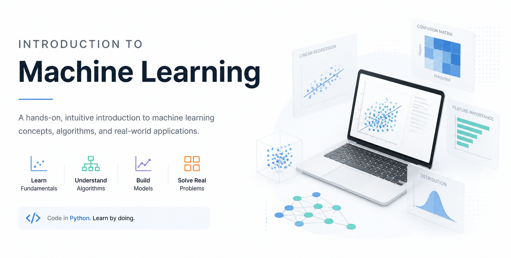

# Introduction to Machine Learning · labs

The notebooks, datasets and lab briefs for the Introduction to Machine Learning course. They take you from a business question to a first model, through regression, classification, trees and boosting, then validation, tuning, explanation, clustering and shipping a model. You clone this repo once and work in it for every lab.

## How a lab is laid out

The labs sit in three folders, `D01`, `D02` and `D03`, in the order the course teaches them. Each lab folder holds:

- `README.md`: the brief. The goal, what you will learn, the data, the tasks, and a **Check yourself** (or **Checkpoints**) table with the values a correct answer prints.
- `Unsolved/`: the notebook you work in. The setup is already filled in; each task has a markdown cell that explains it and an empty cell for your code.
- `Solved/`: the full solution, with its outputs. Try the lab first and open it when you are stuck or when you want to compare. Its last cell prints every Check yourself value.
- `Sample/`: sample answers for the discussion labs, which have no notebook.

The short code in each folder name says how you work on it: `Evr` is a type-along lab that runs every cell with you, `Stu` you work on your own, `Par` with a partner, `Grp` in a small group, and `Lab` is a longer lab with checkpoints C1, C2 and C3.

## Set up

You need Python 3.13, [uv](https://docs.astral.sh/uv/), git, and VS Code with the Python and Jupyter extensions.

Copy the repository's address from the green **Code** button on its GitHub page, then:

```bash
git clone <the address you copied> ml-labs
cd ml-labs
uv venv --python 3.13
source .venv/bin/activate          # Windows: .venv\Scripts\activate
uv pip install -r requirements.txt
```

No git? Choose **Code > Download ZIP** on the same page, unzip it and rename the folder to `ml-labs`. If your laptop does not allow uv, `python3.13 -m venv .venv`, activate it as above, and run `pip install -r requirements.txt`.

The install takes a few minutes the first time. Then, in VS Code:

1. **File > Open Folder**, and choose `ml-labs`.
2. Open `D01/01-Evr-Environment-Check/Unsolved/smoke.ipynb`.
3. **Select Kernel > Python Environments**, and choose the one that ends in `.venv`.
4. **Run All**, and compare the printed versions with that folder's README.

`requirements.txt` pins the packages to the versions the labs were built and checked with (scikit-learn 1.9.1, pandas 3.0.6). A different version can print different numbers from the ones in the Check yourself tables.

## How the notebooks find the data

Every notebook reads its data with a path from the repo root, such as `data/penguins.csv`. `.vscode/settings.json` tells VS Code to run notebooks from the repo root, which is why you open the whole `ml-labs` folder rather than a single notebook.

In JupyterLab or another editor, a notebook starts in its own folder, three levels down. Run `%cd ../../..` in the notebook's first cell, or start from VS Code. `FileNotFoundError: ... data/...` almost always means this.

## The labs

| Folder | What you do |
|---|---|
| `D01/01-Evr-Environment-Check` | Install the environment and check it with the smoke notebook |
| `D01/02-Grp-Six-Problems` | Decide which kind of machine learning fits six requests, or whether a rule does |
| `D01/03-Grp-Place-Three-Products` | Place three products on the training-cadence and inference grid |
| `D01/04-Evr-First-Model` | Build a first model end to end on the penguins data |
| `D01/05-Stu-Leakage-Hunt` | Find the leak in a bank-marketing model that looks too good |
| `D01/06-Evr-Preprocessing-Pipeline` | Fill the blank charges, see what an imputer, scaler and encoder learn, then build one `ColumnTransformer` |
| `D01/07-Lab-Ames-EDA` | Explore the house sales before modeling |
| `D02/01-Par-Audit-AI-Pipeline` | Review a churn model a chat assistant wrote |
| `D02/02-Stu-Ames-Regression` | Fit a linear regression on house prices and read its errors in dollars |
| `D02/03-Stu-Regularization` | Compare linear, Ridge and Lasso models with learning curves |
| `D02/04-Stu-Churn-Classifier` | Build a churn classifier and pick the metric that fits the decision |
| `D02/05-Evr-Tree-Depth` | Draw a decision tree at three depths |
| `D02/06-Lab-Model-Comparison` | Compare four models on one credit-default split |
| `D03/01-Stu-CV-and-Threshold` | Compare models with cross-validation, then choose a threshold |
| `D03/02-Stu-Tuned-vs-Untuned` | Test whether a hyperparameter search is worth it |
| `D03/03-Stu-Explain-Churn` | Explain the churn model with permutation importance, partial dependence and SHAP |
| `D03/04-Lab-Customer-Segmentation` | Segment a year of online sales with RFM and k-means |
| `D03/05-Evr-Ship-Churn-Model` | Log runs in MLflow, serve the registered model by its alias, score a batch, then move the alias and see why a restart is the release |
| `D03/06-Par-Model-Card` | Write the model card for the churn model |

`D03/05-Evr-Ship-Churn-Model` starts and stops its endpoint from the notebook; its README also shows the two-terminal route (one runs the endpoint, the other calls it). It writes `mlflow.db`, `mlruns/` and `scores.csv` into its own folder; `.gitignore` keeps them out of git.

## If something goes wrong

- **A version differs from the smoke notebook's README**: the notebook is not on the `.venv` kernel. Pick it again (point 3 of the set-up).
- **`ModuleNotFoundError`**: same cause, or the install did not finish. Run `uv pip install -r requirements.txt` again with `.venv` active.
- **`FileNotFoundError` for a file in `data/`**: the notebook is not running from the repo root (see "How the notebooks find the data").
- **A value differs from Check yourself**: compare your split first (`test_size`, `stratify`, `random_state=42`), then the task's code. A different value is information, not failure.
- **`Address already in use` in the shipping lab**: an endpoint is still running. Stop it with Ctrl+C in its terminal.

## Getting updates

The labs may be fixed during the course. Before you start a new lab, from the `ml-labs` folder:

```bash
git pull
```

If git refuses because you changed a notebook, keep your work under a new name (`cp file.ipynb file-mine.ipynb`), then `git checkout -- file.ipynb` and pull again.

## Data

Seven tables in `data/`. `data/README.md` gives each file's source, license, rows, the copy used here and its known leaks and quirks.

| File | Dataset | License |
|---|---|---|
| `penguins.csv` | Palmer Penguins (Horst, Hill and Gorman) | CC0 |
| `telco_churn.csv` | IBM Telco Customer Churn | Apache 2.0 |
| `bank_marketing.csv` | Bank Marketing (Moro, Rita and Cortez), UCI 222 | CC BY 4.0 |
| `ames.csv` | Ames Housing (De Cock, 2011), OpenML 42165 | Released for teaching |
| `credit_default.csv` | Default of Credit Card Clients (Yeh), UCI 350 | CC BY 4.0 |
| `bike_hourly.csv` | Bike Sharing (Fanaee-T), UCI 275 | CC BY 4.0 |
| `online_retail_ii.csv` | Online Retail II (Chen), UCI 502, the year 2010-12-01 to 2011-12-09 | CC BY 4.0 |

The four UCI tables are used under the Creative Commons Attribution 4.0 license, https://creativecommons.org/licenses/by/4.0/. `data/README.md` lists the changes made to each copy.
